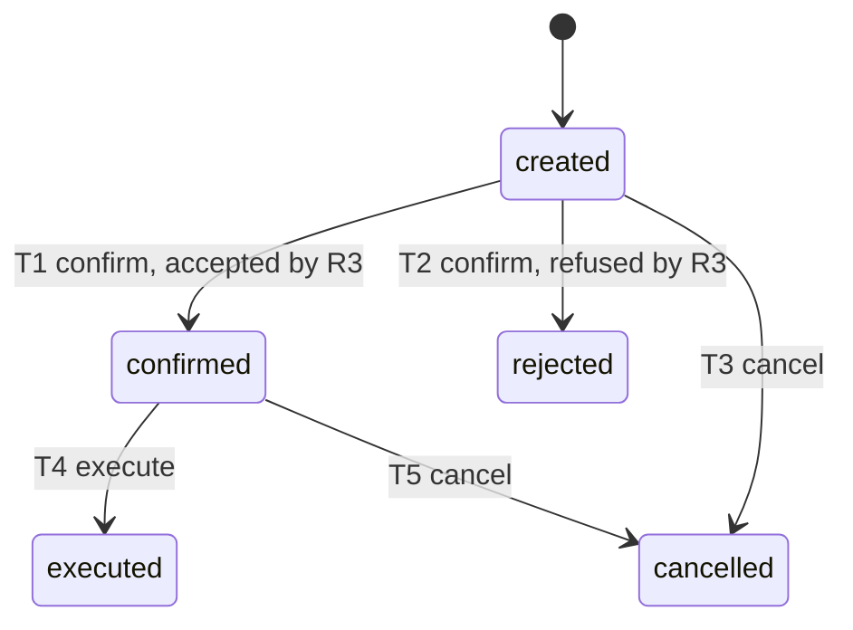

# Business rules

This document specifies the rules of the money-transfer service, for anyone who derives tests from them or changes the service; it is the test basis of the API tests in [tests/](../tests/README.md). Rule ids such as R1 are what the tests and the code cite.

A transfer moves an amount in CHF from an `account` of a type, `private` or `savings`, to a `recipient`. The service holds its transfers in memory, so they last until it stops. The paths, request bodies and responses of its API are generated from the code: start the service and open `/docs`.

## R1: amount range

The amount of a transfer is a number with at most two decimal places, from CHF 0.01 to CHF 10'000.00, both included. A request outside this range is refused with status 422, and no transfer is created.

| Partition | Values | Result |
|---|---|---|
| Invalid, too low | 0.00 and below | 422 |
| Valid | 0.01 to 10000.00 | 201, status `created` |
| Invalid, too high | 10000.01 and above | 422 |
| Invalid, not an amount | more than two decimal places, not a number, `null` | 422 |

## R2: daily limit

The transfers of one account created on the same day, in UTC, may add up to at most CHF 20'000.00. Cancelled and rejected transfers do not count. A transfer that would take the total above the limit is refused with status 422 and the detail `daily limit exceeded`, and no transfer is created.

## R3: confirmation rule

Confirming a transfer may carry a second confirmation, `{"second_confirmation": true}`; a confirmation without it counts as none. Whether the confirmation is accepted depends on the account type, on whether the amount is above CHF 5'000.00, and on the second confirmation. An accepted one takes the transfer to `confirmed`, a refused one to `rejected` (R4).

| Column | D1 | D2 | D3 | D4 | D5 | D6 | D7 | D8 |
|---|---|---|---|---|---|---|---|---|
| Account type | private | private | private | private | savings | savings | savings | savings |
| Amount above 5000.00 | no | no | yes | yes | no | no | yes | yes |
| Second confirmation | no | yes | no | yes | no | yes | no | yes |
| Result | confirmed | confirmed | rejected | confirmed | rejected | confirmed | rejected | rejected |

In words: a private account needs a second confirmation above CHF 5'000.00, a savings account always needs one, and a savings account cannot transfer more than CHF 5'000.00 at all.

## R4: transfer status

A new transfer has the status `created`. Three events change it, each a `POST` to `/transfers/{id}/<event>`: `confirm`, `execute` and `cancel`.

The state table lists the status each event leads to; an event marked as refused is answered with status 409 and leaves the status unchanged. `executed`, `cancelled` and `rejected` are final.

| Status | confirm | execute | cancel |
|---|---|---|---|
| created | confirmed (T1) or rejected (T2) | refused | cancelled (T3) |
| confirmed | refused | executed (T4) | cancelled (T5) |
| executed | refused | refused | refused |
| cancelled | refused | refused | refused |
| rejected | refused | refused | refused |

An event or a read for an id that no transfer has is answered with status 404.
