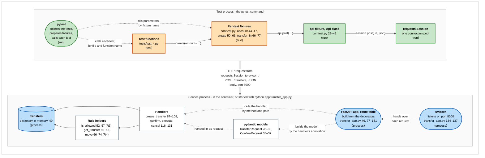
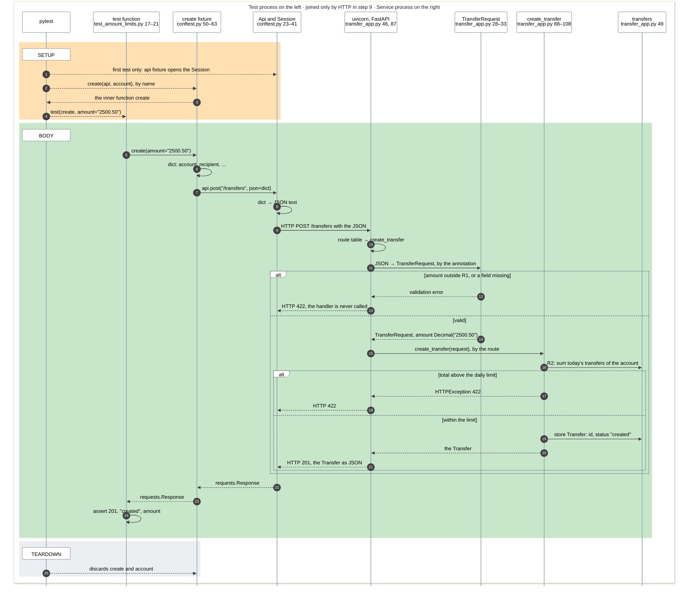
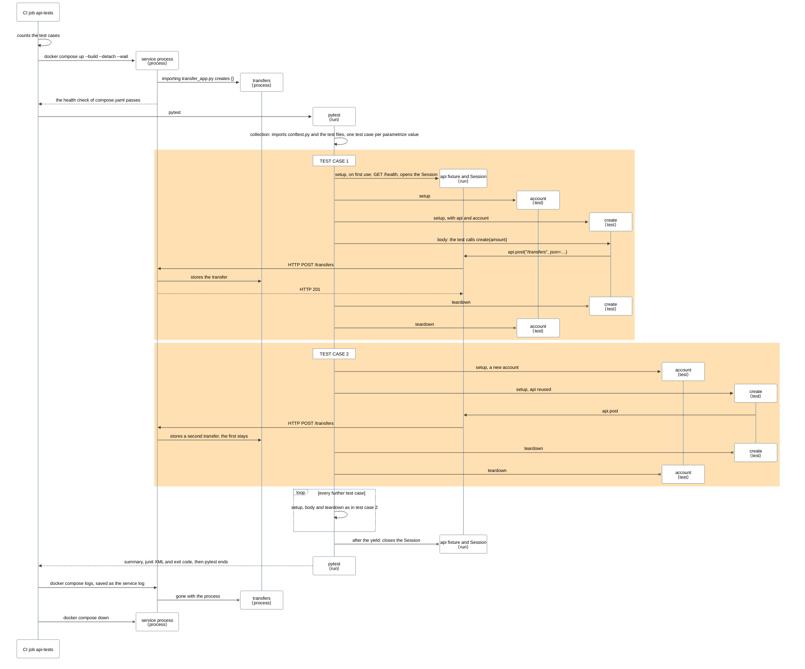
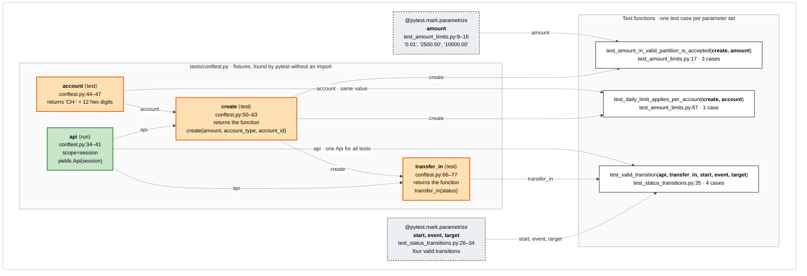

# How the API tests reach the service

This document shows in four diagrams and a table how the API tests in [tests/](../tests/README.md) reach the service in `app/transfer_app.py`, for anyone who reads, changes or explains them: the layers and where each is defined, one request end to end, what runs when and how long each object lives, which fixture provides what to a test, and where two sides must use the same name. The rules the tests check are in [business-rules.md](business-rules.md); how CI starts the service and runs the tests is in the root README's [How it works](../README.md#how-it-works).

## Reading the diagrams

The first and the fourth diagram are flowcharts:

| Mark | Meaning |
|---|---|
| Solid arrow | Our code calls the other side directly, such as `create(amount=…)` |
| Dashed arrow with a label | A framework connects the two sides by a name or convention, which the label states, such as "by fixture name" |
| Thick arrow | An HTTP request between the test process and the service process |
| Rounded box | A framework: pytest, uvicorn, FastAPI |
| Rectangle | Code of this repository |
| Dashed grey box | A `parametrize` argument with its values |
| Cylinder | The `transfers` dictionary, the only state the service keeps |
| Blue, marked ⟨process⟩ | Lives as long as the service process |
| Green, marked ⟨run⟩ | Lives as long as one pytest run |
| Orange, marked ⟨test⟩ | Lives as long as one test case |

The second and the third diagram are UML sequence diagrams. Time runs downwards, and each column is one object with its lifeline:

| Mark | Meaning |
|---|---|
| Solid arrow | A call |
| Dashed arrow | A return, or a call that pytest or FastAPI makes |
| Arrow that bends back to its own column | A step inside that object |
| ✕ at the end of an arrow | The object is destroyed; its column ends there |
| A box partway down a column | The object is created there; before it, the object does not exist |
| `alt` frame | Alternatives: only one of the parts separated by the dashed line happens |
| `loop` frame | The steps inside happen once per item named in its label |
| Coloured band with a label such as SETUP | A phase: setup, body and teardown of a test, or one test case |

A reference such as `conftest.py 50–63` names the file and the lines that define the box; files without a directory are in `tests/` or, for `transfer_app.py`, in `app/`.

Terms: a **fixture** is a function marked `@pytest.fixture`; pytest calls it and passes its result to every test or fixture with a parameter of the same name. `@pytest.mark.parametrize` runs one test function once per listed value; each run is a **test case**, and CI counts test cases. `api` is a fixture and `Api` the class of the object it yields. A **route** is a pair of HTTP method and path that FastAPI maps to a **handler**, a function of `transfer_app.py`.

## The layers and where they are defined

The tests and the service run in two processes that share nothing but HTTP. Inside each process, most connections are made by a framework from a name, not by a call in our code.

- No file imports `conftest.py`: pytest finds it in `tests/` and registers each function decorated with `@pytest.fixture` under its name.
- The only explicit calls in the test process are the solid arrows; everything a test receives, pytest hands it by name.
- In the service, the decorators such as `@app.post("/transfers")` fill the route table when the module is imported, before any request arrives.

## One request end to end

The case `R1-EP-valid-2500.50` of `test_amount_in_valid_partition_is_accepted`, with the form the data takes on each step: a parameter value, a Python dict, JSON text, an HTTP request, a pydantic model with a `Decimal`, a stored `Transfer`, and back.

- Step 1 happens only in the first test case of the run; for this case, the second, the `api` fixture and its `requests.Session` already exist.
- R1 is checked in step 11, before the handler runs: the `Field(ge=…, le=…, decimal_places=2)` of `TransferRequest` refuses the amount, and `create_transfer` never sees it.
- R2 needs the transfers stored so far, so it is checked in the handler; both refusals reach the test as status 422.
- The `Decimal` stays inside the service: the amount comes back in the JSON as a string, which is why the test compares `Decimal(response.json()["amount"])` with `Decimal(amount)`.

## What runs when

The main steps of one CI run of the job `api-tests`, with the lifespan of each object: a column starts where the object is created and ends with the box where it is destroyed. Installing, and keeping the report between the service log and `docker compose down`, are left out.

- The count check compares the number of test cases that `pytest --collect-only` finds with `EXPECTED_TESTS` in `ci.yml`, before the service starts.
- Collection runs before any test: it imports the files and turns each `parametrize` value into a test case of its own; nothing has reached the service yet.
- `scope="session"` makes the `api` fixture run once, when the first test that needs it is set up; its `yield` keeps the `with requests.Session()` block open until the last test has finished.
- `account` and `create` are made again for every test case, so each case gets an account of its own; they are discarded after the test, but the transfers the test created stay in `transfers` until the service stops.

## Which fixture provides what

Three tests, each with the parameters pytest fills for it. Every arrow is made by pytest from a name: a parameter of a test or a fixture names either a fixture or a `parametrize` argument.

- pytest creates each fixture at most once per test case and hands the same object to everyone in that case who names it: the `account` that `test_daily_limit_applies_per_account` receives is the one its `create` uses by default, which is how the test knows which account its transfers went to.
- `create` and `transfer_in` return a function instead of a transfer, so that a test decides when to create a transfer and with which amount, and can create several.
- A `parametrize` argument and a fixture fill a parameter the same way; the only difference is where the value comes from.

## Where the two sides must match

Six hand-overs of a test case work only because both sides spell a name the same way. The steps refer to the request diagram above. Python itself checks ② at the call and ⑥ in the test's own dictionary lookup; pytest, FastAPI and pydantic match ①, ③, ④ and ⑤ while the test runs.

| Hand-over | This side | Must equal | That side | When they differ |
|---|---|---|---|---|
| ① pytest → test, step 4 | `def test_…(create, amount)`, `test_amount_limits.py:17` | parameter name = fixture or `parametrize` name | `def create(…)`, `conftest.py:51`; `parametrize("amount", …)`, `test_amount_limits.py:10` | The test errors at setup: `fixture 'creat' not found`. A `parametrize` name the test lacks fails collection, `function uses no argument 'amount'`, and pytest runs no test at all |
| ② test → create, step 5 | `create(amount=amount)`, `test_amount_limits.py:18` | keyword = parameter name | `def create(amount=…, account_type=…, account_id=None)`, `conftest.py:54` | The test fails with `TypeError: … got an unexpected keyword argument 'amonut'` |
| ③ create → route, steps 9–10 | `session.post(BASE_URL + "/transfers")`, `conftest.py:61` and `31` | method and path = a route | `@app.post("/transfers")`, `transfer_app.py:87` | Status 404 or 405; the test fails on its status assertion, or with a `KeyError` where it reads the body first |
| ④ JSON body → model, step 11 | keys `account`, `recipient`, `account_type`, `amount`, `conftest.py:55–60` | JSON key = field name | fields of `TransferRequest`, `transfer_app.py:28–33` | Status 422 with `"type": "missing"`; a key the model does not know is ignored without an error |
| ⑤ model → handler, step 15 | `class TransferRequest`, `transfer_app.py:28` | annotation = class | `async def create_transfer(request: TransferRequest)`, `transfer_app.py:88` | Without the annotation, FastAPI reads `request` as a query parameter and answers 422 for every body |
| ⑥ response → test, steps 21–24 | fields of `Transfer`: `id`, `status`, …, `transfer_app.py:40–43` | JSON key = field name | `response.json()["status"]`, `test_amount_limits.py:19–21` | The test fails with `KeyError` |
