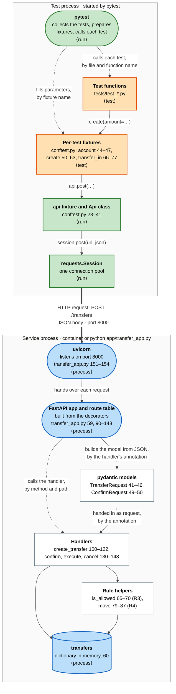
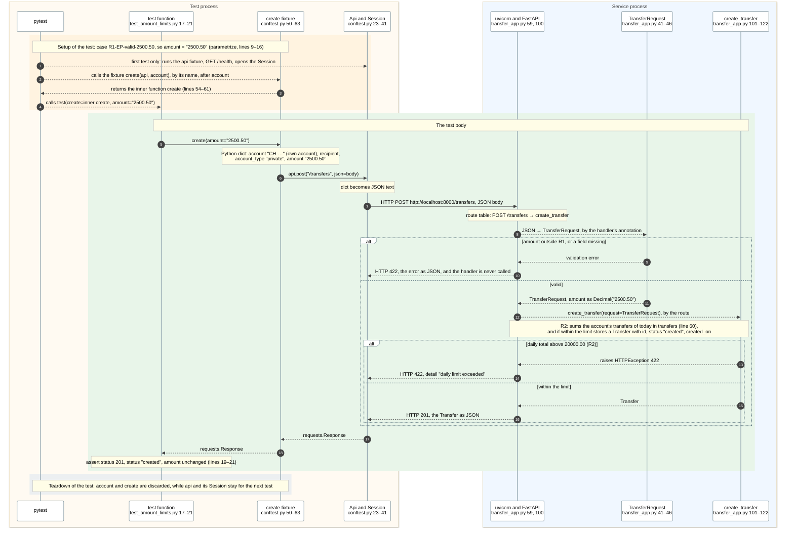
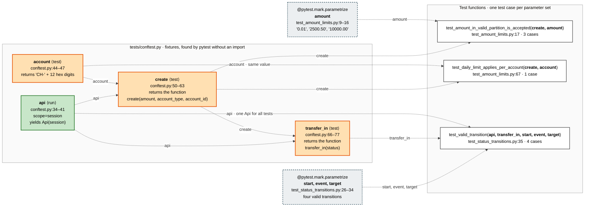
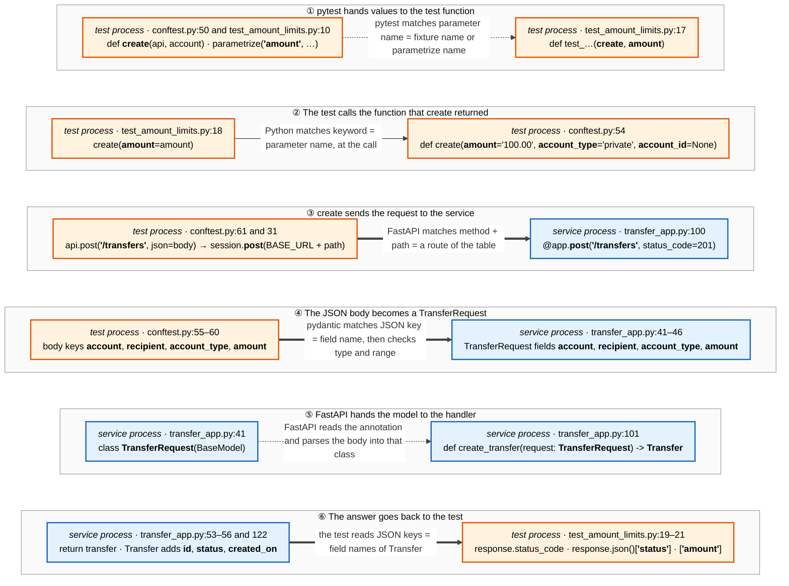

# How the API tests reach the service

This document shows in five diagrams how the API tests in [tests/](../tests/README.md) reach the service in `app/transfer_app.py`, for anyone who reads, changes or explains them: the layers and where each is defined, one request end to end, what runs when and how long each object lives, which fixture provides what to a test, and where two sides must use the same name. The rules the tests check are in [business-rules.md](business-rules.md); how CI starts the service and runs the tests is in the root README's [How it works](../README.md#how-it-works).

## Reading the diagrams

| Mark | Meaning |
|---|---|
| Solid arrow | Our code calls the other side directly, such as `create(amount=…)` |
| Dashed arrow with a label | A framework connects the two sides by a name or convention, which the label states, such as "by fixture name" |
| Thick arrow | An HTTP request or response between the test process and the service process |
| Rounded box | A framework: pytest, uvicorn, FastAPI |
| Rectangle | Code of this repository |
| Cylinder | The `transfers` dictionary, the only state the service keeps |
| Blue, marked ⟨process⟩ | Lives as long as the service process |
| Green, marked ⟨run⟩ | Lives as long as one pytest run |
| Orange, marked ⟨test⟩ | Lives as long as one test case |
| Grey | A step of the CI job, collection or a clean-up, outside these lifespans |

A reference such as `conftest.py 50–63` names the file and the lines that define the box; files without a directory are in `tests/` or, for `transfer_app.py`, in `app/`.

## The layers and where they are defined

The tests and the service run in two processes that share nothing but HTTP. Inside each process, most connections are made by a framework from a name, not by a call in our code.

- No file imports `conftest.py`: pytest finds it in `tests/` and registers each function decorated with `@pytest.fixture` under its name.
- The only explicit calls in the test process are the solid arrows; everything a test receives, pytest hands it by name.
- In the service, the decorators such as `@app.post("/transfers")` fill the route table when the module is imported, before any request arrives.

## One request end to end

The case `R1-EP-valid-2500.50` of `test_amount_in_valid_partition_is_accepted`, with the form the data takes on each hop: a parameter value, a Python dict, JSON text, an HTTP request, a pydantic model with a `Decimal`, and back.

- R1 is checked before the handler runs: the `Field(ge=…, le=…, decimal_places=2)` of `TransferRequest` refuses the amount, and `create_transfer` never sees it.
- R2 needs the transfers stored so far, so it is checked in the handler; both refusals reach the test as status 422.
- The test sees only the `requests.Response`; that the service turned the amount into a `Decimal` shows in the JSON it sends back.

## What runs when

The order of one CI run of the job `api-tests`, not to scale. Each bar lives as long as its colour says: the service and its `transfers` for the whole job, the `api` fixture and its `requests.Session` for the pytest run, and `account` and `create` for one test case.

```mermaid
%%{init: {"theme": "base", "gantt": {"barHeight": 24, "barGap": 6, "topPadding": 40, "leftPadding": 190, "fontSize": 14, "sectionFontSize": 14, "numberSectionStyles": 2}, "themeVariables": {"fontSize": "14px", "sectionBkgColor": "#FFFFFF", "altSectionBkgColor": "#F5F5F5", "sectionBkgColor2": "#FFFFFF", "taskBkgColor": "#FFE0B2", "taskBorderColor": "#E65100", "taskTextColor": "#000000", "taskTextDarkColor": "#000000", "taskTextOutsideColor": "#000000", "taskTextLightColor": "#000000", "activeTaskBkgColor": "#C8E6C9", "activeTaskBorderColor": "#2E7D32", "doneTaskBkgColor": "#BBDEFB", "doneTaskBorderColor": "#1565C0", "critBkgColor": "#ECEFF1", "critBorderColor": "#546E7A", "gridColor": "#E0E0E0"}}}%%
gantt
  dateFormat HH:mm:ss
  axisFormat ·
  todayMarker off

  section CI job api-tests
    count check – pytest --collect-only, 46 expected   :crit, c1, 00:00:00, 00:00:06
    docker compose up --build --wait                  :crit, c2, 00:00:06, 00:00:16
    pytest – runs every test case                     :crit, c3, 00:00:16, 00:01:32
    save the service log                              :crit, c4, 00:01:32, 00:01:35
    docker compose down                               :crit, c5, 00:01:35, 00:01:40

  section Service ⟨process⟩
    image built, python transfer_app.py starts uvicorn :done, s1, 00:00:06, 00:00:13
    health check of compose.yaml passes               :done, s2, 00:00:13, 00:00:16
    answers HTTP requests on port 8000                :done, s3, 00:00:16, 00:01:35
    transfers {} – empty at start, grows with every test, gone at stop :done, s4, 00:00:10, 00:01:37

  section pytest run ⟨run⟩
    collection – import conftest.py and test files, expand parametrize :active, r1, 00:00:16, 00:00:22
    api up to yield – GET /health, Session open        :active, r2, 00:00:22, 00:00:25
    api and Session alive, shared by every test        :active, r3, 00:00:25, 00:01:26
    api after yield – Session closed                   :crit, r4, 00:01:26, 00:01:28
    report – summary and junit XML                     :active, r5, 00:01:28, 00:01:32

  section Test 1 ⟨test⟩
    setup – api on first use, then account, then create :t1a, 00:00:22, 00:00:28
    body – create(amount) sends POST, asserts          :t1b, 00:00:28, 00:00:36
    teardown – account and create discarded           :crit, t1c, 00:00:36, 00:00:38

  section Test 2 ⟨test⟩
    setup – a new account, a new create, api reused   :t2a, 00:00:38, 00:00:41
    body                                             :t2b, 00:00:41, 00:00:49
    teardown                                         :crit, t2c, 00:00:49, 00:00:51

  section Tests 3 to 46 ⟨test⟩
    the same, once per test case                     :t3, 00:00:51, 00:01:26
```

- Before any test: collection imports the files and turns each `parametrize` value into a test case of its own; nothing has reached the service yet.
- `scope="session"` makes the `api` fixture run once, when the first test that needs it is set up; its `yield` keeps the `with requests.Session()` block open until the last test has finished.
- `account` and `create` run again for every test case, so each case gets an account of its own; their objects are discarded after the test, but the transfers the test created stay in the service until it stops.

## Which fixture provides what

Three tests, each with the parameters pytest fills for it. Every arrow is made by pytest from a name: a parameter of a test or a fixture names either a fixture or a `parametrize` argument.

- pytest creates each fixture at most once per test case and hands the same object to everyone in that case who names it: the `account` that `test_daily_limit_applies_per_account` receives is the one its `create` uses by default, which is how the test knows which account its transfers went to.
- `create` and `transfer_in` return a function instead of a transfer, so that a test decides when to create a transfer and with which amount, and can create several.
- A `parametrize` argument and a fixture fill a parameter the same way; the only difference is where the value comes from.

## Where the two sides must match

Each of the six hand-overs of a test case works only because both sides use the same name. Only the solid arrow is checked by Python at the call; the dashed and thick ones are matched by a framework at run time.

What happens when the two sides of a hand-over do not match:

| Hand-over | Mismatch | What you see |
|---|---|---|
| ① parameter → fixture | A parameter names no fixture, such as `creat` | The test errors at setup: `fixture 'creat' not found` |
| ① parameter → parametrize | `parametrize` names an argument the test does not have | Collection fails, `function uses no argument 'amount'`, and pytest runs no test at all |
| ② keyword → parameter | `create(amonut="1.00")` | The test fails with `TypeError: … got an unexpected keyword argument 'amonut'` |
| ③ method and path → route | A path the route table lacks, or another method on a known path | Status 404 or 405; the test fails on its status assertion |
| ④ JSON key → field | A required key missing or misspelled, or a value outside its type or range | Status 422 with `"type": "missing"` or the failed check; a key the model does not know is ignored without an error |
| ⑤ annotation → body | The annotation `: TransferRequest` removed | FastAPI reads `request` as a query parameter and answers 422 for every body |
| ⑥ JSON key → test | The test reads a key the response lacks | The test fails with `KeyError` |
